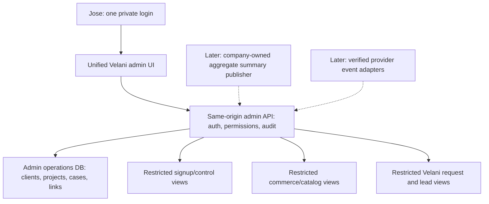

# Private Velani admin: investigation and proposed design

November 10, 2026 · America/Puerto_Rico · **Investigation complete; design proposed; implementation not started.**

## Recommendation

Build one private Velani admin application with one login for Jose and separate NEVORA and Velani sections. Give it its own authenticated backend and small operations database. Connect that backend to carefully limited views of the existing signup, commerce and client-request records. Keep customer workforce databases and provider management credentials outside the dashboard's normal access.

Jose explicitly selected both product sections and Jose-only initial access. A unified private admin was explained in response to his clarification. The architecture below is a recommendation for review, not an approved implementation or permission to activate infrastructure.

The first release should provide real company/request visibility plus an internal client/project workflow. It should not include refunds, subscription changes, workplace suspension, deletion, customer impersonation or automatic email retries. Those actions need separate source-owned commands and stronger operational evidence; they are not ordinary CRUD buttons.

Companion documents: [draft API contract](api-contract-draft.md), [delivery plan and acceptance gates](delivery-plan.md), [verified observations](observations.json), [source index and provider references](sources.md).

## What the investigation actually checked

- Read the NEVORA signup assembly at `0c414ae65` / deployed application `3922df94`, its AGENTS.md, control migrations, grants, setup/readiness logic, provisioning journals, commerce models, Owner authority and operator commands.
- Read the Velani client-hub source at `ef9dbe29`, its AGENTS.md, form contract, request/outbox schema, email retry logic, retention code and deployment configuration. Read Claude's website handoffs without changing its checkout or untracked evidence.
- Queried only live schema metadata and aggregate counts in the production control/catalog and Velani assistant databases. Read no customer records, message bodies, passwords, keys or financial transactions.
- Checked actual Vercel project/alias/team metadata through the existing authenticated CLI after the connector returned a scope-dependent 404. Checked public config/ready endpoints. Discovered Stripe account connections without reading payments or changing mode.
- Consulted current official Google, OWASP, Stripe, Resend, Neon and Vercel documentation. No application code, schema, DNS, credentials, paid plans, emails, payments or deployments changed. No product tests or UI acceptance were run for a feature that does not exist yet.

## Existing capability versus missing work

| Area | Verified today | Required for your admin |
|---|---|---|
| NEVORA signup | Central registration states, company registry, provisioning attempts, current lifecycle and separate private credentials | Safe cross-company list/detail views; a private platform-admin identity; useful attention queues |
| NEVORA billing | Catalog accounts/businesses, trial dates, payment/access calculation, authenticated customer billing interface | Read-only administrative projection; source freshness; mode separation; live financial integration qualification |
| Company setup | Full setup/configuration exists behind that company's actual Owner session | A separate minimal aggregate summary publisher if global setup completion/current headcount are wanted; the admin must not impersonate an Owner |
| Velani website | Anonymous new-work/support submissions, references, frozen email jobs, delivery uncertainty and 88–90-day cleanup | Protected request inbox, triage status, notes and explicit links to clients/projects |
| Rondo enquiries | Consented lead records and a private export script; chat retention is separate | Optional lead inbox using explicit lead records, not chat transcripts; qualified lead-retention coverage |
| Client/project management | No client/project/admin tables found in the checked Velani database; request company/project values are free text | Small registry of business relationships, contacts and projects, with workflow and provenance |
| Security | Company-specific Employee ID/password and customer billing proofs | Independent platform-admin authentication, MFA, sessions, authorization, access audit and recovery |
| Operations | CLI procedures and source journals exist; some production worker activation remains separate | Honest last-observed health, attention items and links to runbooks; no invented green status |

Observed Velani counts were zero requests, zero outbox jobs and zero Rondo leads. That is a count of those sources at observation time, **not evidence that Velani has no clients**, and not proof about support-email history. Existing customers managed outside these records require a reviewed import/manual entry.

Only the connected **Velani LLC sandbox** Stripe account was available. Live Stripe access was not verified. The dashboard must show live revenue as unavailable, not zero. Vercel's latest attempted Velani deployment was BLOCKED, but the actual `velani-ai.vercel.app` alias still pointed to the older READY deployment at `d89350bd`; latest attempt and live alias are different states.

## One admin, two product sections

Suggested navigation, for Claude to design:

| Screen | Purpose |
|---|---|
| Overview | Known NEVORA companies, current trials, open Velani requests/projects and items requiring attention, with coverage/freshness |
| Clients | One internal business profile, its contacts, linked NEVORA workplaces and linked Velani projects/requests |
| NEVORA | Company list, activation stage, trial/billing state, company sign-in address and technical provisioning history |
| Velani projects | Manually managed project name, client, stage, optional target date and internal notes |
| Requests | New-work/support inbox, requested urgency, language, reference, email state and triage status |
| Activity and system | Administrative changes, relevant access audit, source connection state and missing/stale information |
| Your access | Your enrolled factors, session/logout and recovery procedure; no team invitation feature in v1 |

This is an information architecture, not a UI mockup. Claude owns page composition, typography, components, responsive behavior and EN/ES presentation.

Example: a café buys NEVORA and also asks Velani for a website. Its internal client profile can explicitly link the NEVORA workplace UUID and the website project. An unverified request with a similar café name does not merge automatically. Each workplace still has its own sign-in and isolated workforce database.

## Exact first-release scope

### NEVORA visibility

Include canonical workplace ID, registered portal address, source environment, lifecycle/revision/incarnation, company name and billing contact **as recorded at enrollment**, activation stage, trial dates, catalog access state and sanitized provisioning reason codes. Show the difference between account setup, provider creation, Owner activation and a paid subscription.

Important limits:

- Registration email and provisioning payloads are encrypted. The admin will not receive onboarding encryption roots. A pre-provisioning registration can be shown by short internal ID, stage, locale and dates; email/name search is unavailable until an approved non-secret business record exists. Do not export encrypted payloads to make a prettier table.
- `commerce.accounts.profile` contains the enrollment name/contact; it does not prove the current Owner or current workplace name after later edits. Label provenance. The first release does not silently promise those fields are live company-directory facts.
- Company setup readiness is computed in `setup.server.ts` from company data under a current Owner session. It is not a reliable global column to read from registration state. V1 shows **activation stage**; detailed setup readiness, current headcount and worker heartbeat become available only through the separate summary connector in the next phase. Unsupported cards remain absent/unavailable, not guessed.
- Never call customer `/v1/status` using a fabricated Owner proof. A new platform-admin route reads safe catalog facts and reuses pure access-policy logic, without acquiring customer session authority.
- Paid conversion does not mean completed onboarding; ACTIVE in the registry does not mean paid or all workers healthy.

### Velani business workflow

Create minimal internal records:

- Client/business: display name, relationship state `prospect|active|inactive`, verified contact records, optional legal/company name, notes, timestamps and revision.
- Contact: name, business email, optional phone, language and verification/provenance. A website submission is an asserted contact, not a verified login or customer identity.
- Project: client link, name, stage `planned|in_progress|waiting_client|completed|canceled`, optional target date and plain-text internal notes. No invoicing engine, tasks suite, files or contracts in v1.
- Request case: source request/lead ID, reference, triage `new|reviewing|waiting_client|resolved|closed`, optional client/project links, follow-up date and notes. Requested urgency remains separate from triage and does not create a service-level promise.
- Links: manually reviewed relationships between one client and one or more external workplace IDs/requests/projects. One external workplace may link to only one internal client. Email/name similarity can suggest a possible match but never merge identities automatically.

Source forms remain unchanged. Their public reference is not authentication and does not become a public request-status URL. A client-hub request does not itself create a NEVORA workplace or paid client. Admin relationship status does not change NEVORA access or subscriptions.

Requests over 30 staff can be triaged as NEVORA assisted setup. The approved assisted policy is eligibility review, the same 30-day no-card trial for approved teams starting at provisioning, and a response target within two business days. The current self-service API still rejects over 30 and there is no complete assisted provisioning workflow. V1 may track that enquiry; it must not bypass the existing limit or claim the trial has started. Holiday/business-calendar handling remains to be specified before automatic SLA deadlines are added.

### Explicitly deferred

Customer impersonation; employee/payroll/attendance browsing; full Rondo conversation browsing; Gmail mailbox ingestion; customer-facing ticket accounts; attachments; marketing campaigns; automatic client merging; bulk PII exports; refunds/charges/cancellations; editing trial entitlements; suspension/reactivation/deletion; re-running an uncertain provider operation; retrying uncertain email; arbitrary SQL; database restores; and opening public signup. None is necessary to deliver the initial management dashboard.

## Architecture and alternatives

**Recommended:** a dedicated small TypeScript/Next.js admin app and same-origin backend, hosted in an existing eligible account, with a separate admin operations database. Proposed hostname `admin.thevelani.com`; it is not registered, configured or activated by this investigation. Confirm ownership and exact DNS recommendation during implementation.

The browser receives no database or provider credential. The admin web service has no Neon organization-management key, company APP/WORKER connection, onboarding encryption root, Stripe write key or email-sending key. New source readers can SELECT only approved views/columns and cannot access the base secret/token tables. The admin's own write role can update only its internal business records and append audit/idempotency records.

**Other viable approach:** a reporting tool for a read-only overview, with restricted views and separate operational tools. It is quicker for counts but still needs custom services for linking requests, managing projects, audit and later support commands. It adds another permission/hosting surface or subscription. It does not fully satisfy the requested unified management workflow.

**Not recommended:** adding global administration to each company's existing Owner UI or embedding privileged APIs in Shopify/Rondo. A company Owner is not a Velani platform administrator; Shopify is a public storefront. That would broaden the wrong trust boundary and couple operations access to customer releases.

This is one application, not a microservice platform. No Kafka, Redis, warehouse, realtime subscription or AI service is justified for one operator at launch. Use existing TypeScript/PostgreSQL skills and small adapters. Future admin source paths in the delivery plan are proposals, not files already created.

## Data authority and source adapters

| Data | Authority | V1 handling |
|---|---|---|
| Workplace existence, origin, lifecycle, revision/incarnation | NEVORA control registry | Limited read view, exact environment and source identity |
| Registration/provisioning stage | Control journals | IDs, states, dates, stable reason codes; no ciphertext, tokens, resource JSON or raw errors |
| Enrollment business/contact and trial/access record | Commerce catalog | Explicit fields only; enrollment contact is not current Owner authority |
| Current company setup/headcount/name | Company application | Unavailable in v1 global view; later aggregate connector, not Owner impersonation |
| Subscription/invoice/actual collected revenue | Verified live Stripe source, reconciled commerce state | No revenue totals until live identity, mapping and freshness are qualified |
| Submitted request/lead and original message | Velani source | Read on demand, no permanent copy of message/payload in admin storage |
| Email submission state | Source outbox | Preserve pending/processing/submitted/blocked/uncertain semantics |
| Delivered/bounced event | Verified Resend event/receipt | Add only when observed and correlated to a known source job; submitted alone is not delivered |
| Client relationship/project/case status | New admin operations DB | Human-managed internal data, independent of billing and customer records |
| Security/administration history | New append-only application audit | Runtime cannot edit/delete its audit; owner-level access is not claimed to be immutable WORM storage |

Views must expose a named field allowlist. A view is not safe merely because its name contains admin. Inspect actual effective role, base-table privileges, view ownership/security behavior, search path, membership and denied secret access with isolated database tests. Use dedicated readers for control, catalog and Velani; do not reuse the much broader customer APP or provisioner principal.

Cross-database identity uses stable source IDs plus environment and, for workplaces, incarnation/revision. No cross-database foreign keys and no browser-selected DSN/host. Legacy workplaces outside the registry need a reviewed inventory/import; listing every Neon project would not establish a customer relationship. Show coverage as partial until that inventory is reconciled.

## Authentication, authorization and recovery

Proposed access design: Jose's individually controlled Google account via server-validated OIDC, followed by an application-bound WebAuthn/passkey challenge requiring user verification. Use maintained libraries; do not write OAuth/JWT/WebAuthn cryptography. Google tokens must be checked for issuer, signature, audience, expiry, state/nonce and verified identity. Pin the approved immutable provider subject; matching an email domain or `hd` hint is insufficient. Request only `openid email`; no Gmail, Drive or Contacts scope. Google sign-in alone is not evidence that this app enforced MFA. [Google OIDC](https://developers.google.com/identity/openid-connect/openid-connect), [passkey server verification](https://developers.google.com/identity/passkeys/developer-guides/server-authentication).

- One explicitly enrolled `platform_owner`; no first-user-wins, self-signup, shared support-mailbox account, public invitation or inference from a NEVORA OWNER role.
- Verify Jose's exact personal admin identity and enrollment procedure before deployment. This investigation does not know or choose the identity for him.
- Register primary and independent backup factors under Jose's direct action. Recovery must require a separately controlled factor or an explicit private operator identity-verification procedure. No email-only bypass, shared emergency password or customer-session fallback.
- Opaque revocable server-side sessions; host-only Secure/HttpOnly cookies, no localStorage bearer. Proposed 30-minute idle and 8-hour absolute expiry. Require recent passkey verification within 5 minutes before internal identity/link changes; rotate session on login/recovery and revoke all sessions on account disable/recovery.
- OIDC callback state/nonce handling uses a dedicated short-lived callback cookie; the full authenticated admin session can use SameSite Strict. Enforce exact Origin and CSRF on mutations, bound bodies, and same-origin UI/API. CORS and hidden navigation are not authorization.
- Every route and object lookup checks active platform authority server-side. Disabled admin/user revocation is checked on requests, not only in a long-lived token. Preview and Production use different identity configuration, sessions, keys, DSNs and datasets.
- Access logging includes full-contact/message detail reads and business writes; no raw session tokens, passwords, proofs, request messages or provider secrets in audit/runtime logs. Login/overview must not load third-party analytics/replay or marketing scripts.

These are proposed controls to implement and test, not claims that new admin authentication already exists. [OWASP object authorization](https://api-security.owasp.org/editions/2023/en/0xa1-broken-object-level-authorization/), [session guidance](https://cheatsheetseries.owasp.org/cheatsheets/Session_Management_Cheat_Sheet.html).

## Correct numbers and honest failure states

- Do not equate registrations, requests, workplaces, clients and subscriptions. They are separate entities with separate counts.
- Count distinct canonical workplace IDs for NEVORA companies; default to Production and exclude explicitly classified internal/test fixtures. The owned acceptance workplace is synthetic despite residing in production infrastructure. Never infer real-customer status solely from environment or domain.
- Count clients from the internal registry; one client can own multiple workplaces and projects. Do not count a free-text website company as a verified client.
- Trial count requires a valid trial end in the future, an enrolled business and correct access precedence; paid-through can override a concurrent trial. Use source policy, not a UI timer. Trial duration is 30 days, and the admin adds no workplace-deletion countdown.
- Live revenue is null/unavailable until a verified live source exists. Later use settled invoice/payment data with explicit currency/refund/tax definitions. MRR is recurring subscription value, not cash collected and not count × marketing price. Multi-currency totals must remain separate unless a documented conversion policy is approved. V1 does not claim MRR/churn/cohort analytics.
- Source wrappers return observedAt, source/environment, coverage and freshness. Partial failure keeps available sections visible and marks missing ones unavailable; total source outage yields 503, never zero clients or all healthy. No distributed atomic snapshot is promised across three independent databases.
- Live headcount, setup completion and worker health cannot be inferred from enrollment count, ACTIVE state, a migrated monitor table or HTTP 200. Show last actually observed evidence, or unavailable.
- Queries are bounded and parameterized. Default page 25/max100; stable opaque cursor; search via authenticated POST body to avoid contacts in URLs; no arbitrary SQL/sort/URL fetch. Lists omit messages and full contact details where unnecessary.
- Initial refresh is on demand with a 60-second private cache keyed by environment/source/actor. Refresh only visible screens. Do not poll every company database or hold all Neon computes awake. No global background fan-out in v1.

## Writes, retries and later dangerous commands

V1 writes are confined to the new operations DB: clients/contacts, projects, case status, reviewed source links and notes. Every write has an operation UUID, expected decimal-string version and deterministic request fingerprint. In one transaction: verify authority/recent factor where needed, compare version, apply mutation, append audit and save replay receipt. Same ID/body returns the original receipt; changed replay or stale revision returns 409. HTTP disconnects never trigger a new logical operation automatically.

Later external operations need a separate durable command/outbox workflow: actor, reason, exact source identity, expected revision/incarnation, preview of impact, fresh step-up, stable provider key, serialized lease/fence, explicit pending/succeeded/failed/unknown and reconciliation. Restores and destructive actions stay manual approved procedures; the earlier snapshot-finalization incident demonstrates why raw provider buttons are unsuitable. No credentials or guessed Owner proofs are a shortcut.

Stripe webhooks must verify signatures, pin account/mode, deduplicate event IDs, tolerate out-of-order events and reconcile authoritative objects. Resend event verification must retain raw request bytes and deduplicate provider event IDs; only mapped source messages are eligible. Neither a webhook arrival nor a return redirect is proof of the desired business result. Resend deduplication is time bounded; never reset an unknown job to force a retry. [Stripe](https://docs.stripe.com/webhooks), [Resend verification](https://resend.com/docs/webhooks/verify-webhooks-requests), [idempotency window](https://resend.com/docs/dashboard/emails/idempotency-keys).

## Privacy and retention

Current rules remain intact: Rondo conversation retention 30 days; client-hub request/outbox eligibility begins at 88 days with a target up to 90 days; support/client mailbox copies and provider backups are separate. The signup cleanup retires ephemeral proof material while preserving business provenance; registration expiry is not a guarantee that the entire row or workplace is deleted.

New admin storage must not become an indefinite copy of source requests. V1 reads request body on demand, retains only the source reference/status in its case, and checks source expiry on access. No copying full descriptions, frozen email bodies, chat transcripts or employee data into notes/search indexes.

Proposed new policy, **requires Jose's approval before production use**:

| Record | Proposed retention |
|---|---|
| Unconverted prospect/request-case notes and contact suggestions | No longer than 90 days from source submission, or original creation for a manually entered prospect; editing/follow-up does not restart the clock; stop serving expired source content immediately; sweep with 48-hour headroom |
| Minimal engaged client/contact/project records deliberately promoted for service delivery | Active relationship plus 12 months after explicit closure; reassess continuing obligations before approval |
| Request content | Never duplicated; follows source eligibility/availability |
| Security/access audit without message/contact payloads | 365 days; IDs and safe action/result metadata only |
| Short-lived source caches | At most 60 seconds; no durable body cache |
| Admin database restore history | Proposed 7 days, with deletion tombstone replay before a restored database is served |

These are operational proposals, not legal retention requirements or changes to NEVORA workplace retention. New privacy purpose/disclosure, correction/deletion workflow, legal-hold procedure and restore deletion replay must be agreed before customer information is collected in the admin registry. A promotion copies only minimal verified business-contact fields after explicit review; it never extends retention of the original request/chat body.

### Proposed closure and retention state machine

Jose selected the closure rule for this plan on November10: Inactive means a closed internal business relationship, starting the proposed12-month period; reopening requires confirmed new work, and source/prospect deadlines do not restart. No live retention policy was changed. The detailed command safeguards below implement that selected direction; final design/disclosure and production approval remain separate. Store original prospect expiry, first engagement time, current closure time and any reviewed hold separately from editable display status.

- New prospect: expires90days from its original source submission, or original manual creation when it has no source. Edits, notes and follow-up dates never reset that expiry.
- Prospect→active: an explicit recent-factor command confirms a real service relationship and promotion of only minimal client/contact/project records. Record engagement time and the safe reason code. Source cases/descriptions retain their original deadline.
- Active→inactive: means explicit closure of this internal business relationship, not workplace suspension. Require all projects terminal and no fresh known linked NEVORA paid/trial/grace access; unavailable linked billing evidence blocks closure rather than silently starting a timer. Record closedAt once for this closure and schedule minimal business records for deletion12calendar months later. Repeated inactive saves/notes do not restart the clock.
- Unconverted prospect→inactive: closes the prospect but preserves its original90-day expiry; it does not gain12months. Reopening it before expiry also preserves that original deadline.
- Inactive previously engaged client→active: before expiry, an explicit recent-factor command confirms a new service relationship, records a new engagement cycle and clears the current closedAt/closure deadline. A later real closure starts a new12-month period; ordinary editing cannot do this. Never restore already expired/purged data by toggling a state.
- Active/previously engaged→prospect is forbidden. Once erased, a genuinely new relationship starts a new minimal record; no old request/contact body is resurrected.
- Cases and case notes are independent of client promotion/reactivation: source content access stops at the source expiresAt (normally88days for the hub); cleanup of transient case metadata/notes completes by source submission+90days. Linking to an active client/project does not extend that deadline. Any retained project milestone is a new minimal business fact, not a copied source message.
- An independently reviewed legal/erasure hold can pause the relevant business-record purge, with reason/owner/review date. It does not preserve source request bodies beyond their own policy or change financial-provider/workplace retention. Holds require a private operator procedure in v1 and must be honored by cleanup/restore.

All transitions use expected versions and an atomic audit receipt. Closing a client serializes with project creation/reopening and recent source-evidence checks; source uncertainty fails closed. The selected plan policy is not activated until the design, disclosure/retention and production gates pass.

Rondo's manual retention script includes 90-day lead deletion, but the scheduled conversation-retention handler inspected is sessions-only. Automatic lead cleanup was not established by this investigation. Before including a lead inbox, either qualify an independent lead-cleanup job with a restricted role or defer that adapter. Client-hub automatic runs likewise need actual last-run evidence for the dashboard, not just cron registration. No mailboxes were read here.

## Cost and hosting findings

The actual Vercel team reports **Hobby**. Vercel's current policy restricts Hobby to personal/non-commercial use. Its current Pro platform fee is **$20/month**, including one deploying seat and $20 usage credit. Treat this as a shared team hosting line, not $20 for every client or app. Existing Google/Neon/Vercel accounts should be used; no new subscription was started. [Hobby policy](https://vercel.com/docs/plans/hobby), [Pro plan](https://vercel.com/docs/plans/pro-plan).

Neon Launch currently lists $0.106/CU-hour, $0.35/GB-month database storage and separate history/storage charges. Illustrative new admin compute: a 40 CU-hour monthly quota is $4.24 compute plus storage/history; a fixed 0.25 CU running 24/7 for 30 days is about $19.08 compute. This is why on-demand reads and no per-company polling matter. Source databases awakened by admin reads also incur usage. [Neon pricing](https://neon.com/pricing), [scale to zero](https://neon.com/docs/introduction/scale-to-zero).

Planning allocation: shared Vercel Pro $20, new admin database/usage target $5–10/month at initial traffic, and measured shared source/host overhead. A rough incremental planning range is $25–35/month including the currently missing team upgrade, **not a guaranteed bill**. If Pro is upgraded for the wider launch first, do not charge that line twice. No new email or AI spend is needed for v1.

The previously approved $100/month is an aggregate additional production-infrastructure ceiling, not an extra $100 for this dashboard. Current full account spending/headroom, other planned workers and invoice details were not inspected. Reconcile them before activation. Quotas/request caps and billing alerts are different from a hard dollar cap; provider reporting can lag. Pause nonessential admin refresh/sync first when headroom is low; do not silently pause customer operations. No plan upgrade or paid resource activation is authorized by this investigation-only task.

## Delivery and acceptance

Build in independently testable phases, detailed in [delivery-plan.md](delivery-plan.md):

1. Approve scope, identity/recovery, proposed retention and budget allocation; inventory known clients/workplaces; freeze admin API v1 as a contract for Claude.
2. Establish isolated admin auth, sessions, audit and the internal operations database with synthetic staging data.
3. Add restricted source views/read adapters and company/request lists with honest partial/unknown/freshness states.
4. Add internal client/project/case/notes/link commands with optimistic versions and idempotency. Claude builds the unified UI against the fixed contract.
5. Qualify end-to-end browser/security/database/retention/restore behavior, exact source/deployment/identity, then an explicitly authorized read-only production pilot and separately enabled internal business writes.
6. Later: company aggregate summaries, source health/event feeds and narrowly reviewed operational commands. Live financial metrics and assisted provisioning depend on their existing unfinished backend work; they do not block useful read-only/client-project visibility.

Do not reopen public signup or change live Shopify billing settings as part of admin rollout. The admin is a separate release, not proof that the entire NEVORA customer launch is complete.

## Decisions and remaining evidence

Confirmed: both sections; Jose only; Inactive/closure and reactivation direction selected for the plan, preserving original source/prospect deadlines. Proposed for overall design review: dedicated unified app; same-origin API; separate operations DB; Google OIDC plus passkey; view-only customer data plus internal workflow writes; phased summaries/actions; remaining retention table and cost allocation above.

Before implementation approval: Jose reviews those proposed calls. Before production: verify exact individual identity/recovery factors, hosting eligibility/headroom, approved admin origin, legacy client inventory coverage, retention disclosure, least-privilege source grants and isolated Preview. No need to ask him again whether both product sections or multiple users are required; those choices are settled.

Product position: useful visibility and follow-up first. Engineering position: one small app with bounded source adapters. Security position: independent admin identity, no global secret access or customer impersonation. Governance position: GO for this investigation/design review; implementation and production remain separate authorizations. Independent builder review is recorded in `builder-review.md` when returned; it is not production/security certification.
